<p align="center">
  
</p>

<h1 align="center">Sentury</h1>

<p align="center"><b>Um agente de IA que trabalha no seu computador, com você vendo cada passo.</b></p>

O Sentury conversa, pesquisa, lê e escreve arquivos, roda comandos, abre o
navegador e usa a tela, e entrega o resultado desenhado na própria conversa. Ele
lembra do que você ensina, cria colegas que trabalham sozinhos e para antes de
tudo que tem consequência para pedir o seu ok. Roda na sua máquina, com o modelo
que você escolher, e guarda tudo em arquivos que você pode abrir.

**Documentação completa: [docs/](docs/README.md)**

## Veja em ação

Pergunte "Como está o meu HD?" e a resposta vem desenhada: o uso de cada disco,
o que ocupa o espaço, as maiores pastas e um simulador para ver quanto sobra se
você apagar parte dos vídeos.

<p align="center">
  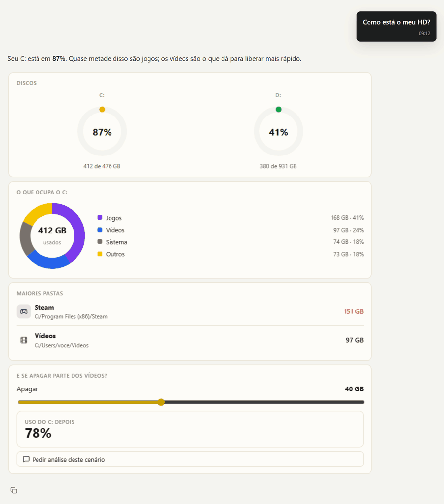
</p>

Pergunte por que o site ficou lento: você vê cada ferramenta trabalhando, a
fonte que não respondeu sendo contornada, e a resposta com o que mudou.

<p align="center">
  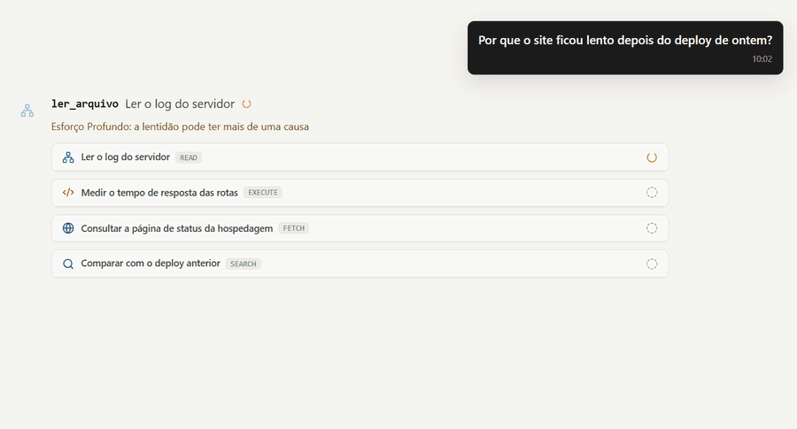
</p>

Peça um programa e ele escreve o código e os testes, roda, lê a falha e corrige
até passar. Aqui o teste pegou um caso real: o CSV salvo pelo Excel começa com
um marcador invisível que grudava no nome da primeira coluna.

<p align="center">
  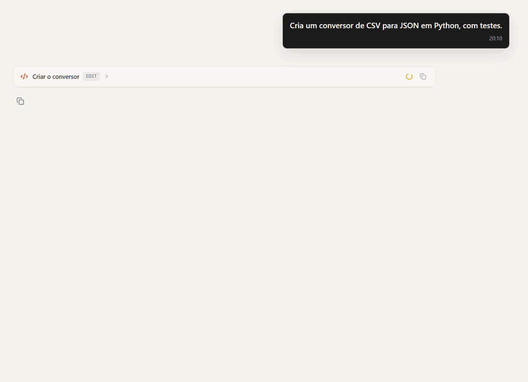
</p>

O mesmo pedido gravado ao vivo, sem corte, com o Codex como modelo. Ele para
duas vezes para pedir aprovação, uma para gravar os arquivos e outra para rodar
os testes, e entrega com os três testes passando.

<p align="center">
  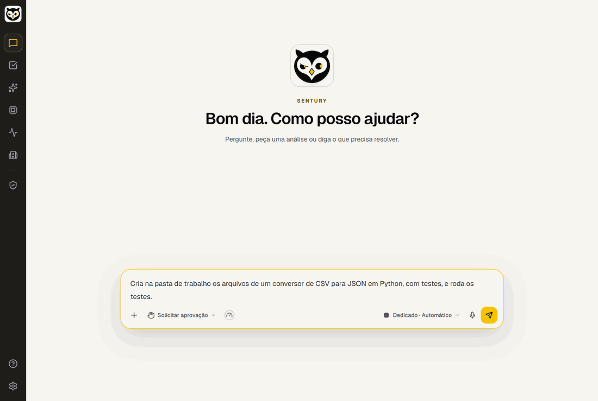
</p>

<table>
  <tr>
    <td width="50%"><b>A cor que o dado pede.</b> Verde para o que bateu a meta, vermelho para o que ficou para trás.</td>
    <td width="50%"><b>Ícones de programa.</b> Uma tabela própria de programas; o que está fora dela ganha a inicial.</td>
  </tr>
  <tr>
    <td>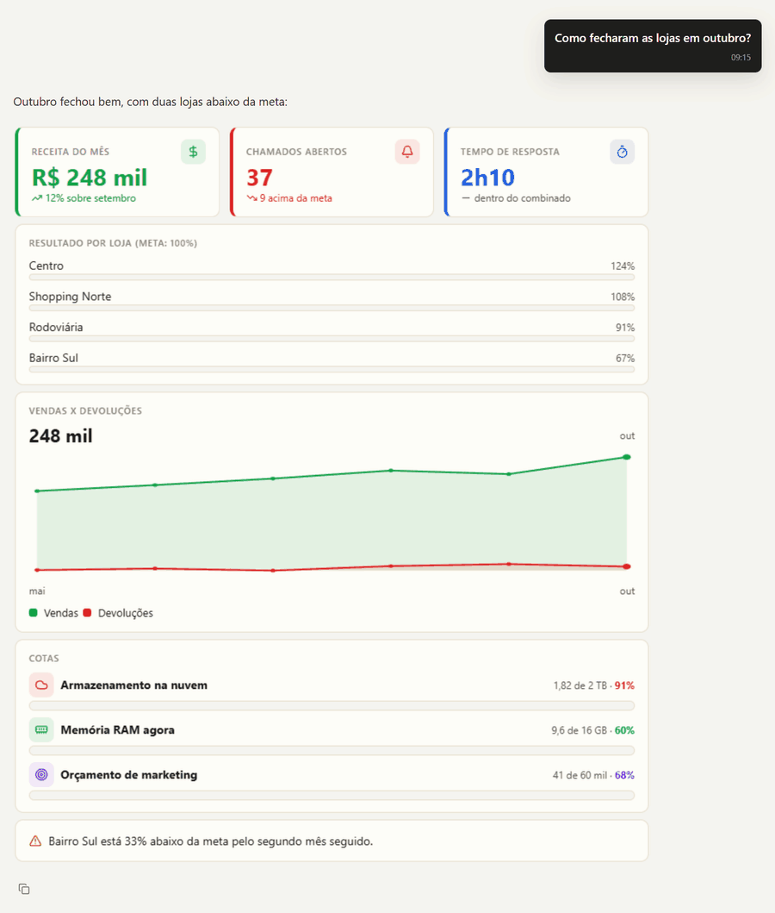</td>
    <td>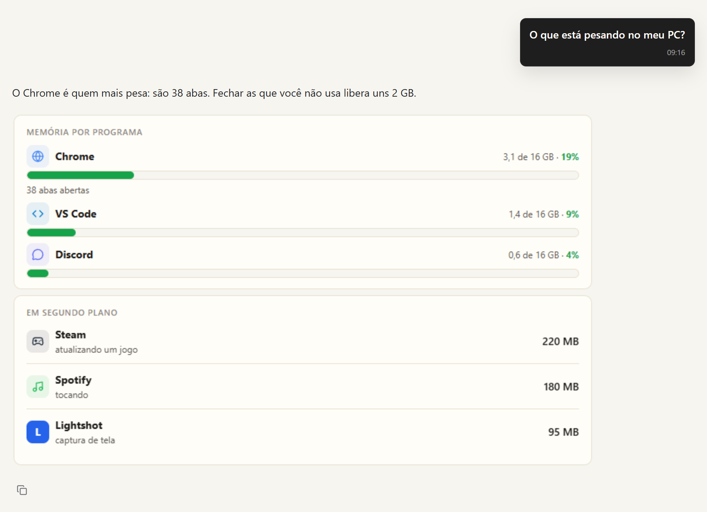</td>
  </tr>
  <tr>
    <td><b>Código que você pediu continua código.</b> E o Visualizar desenha no mesmo quadro isolado.</td>
    <td><b>O que ele aprendeu fica à vista.</b> Recolhido embaixo da resposta, com desfazer em cada item.</td>
  </tr>
  <tr>
    <td>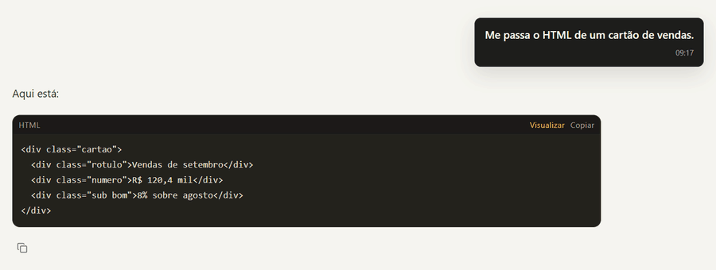</td>
    <td>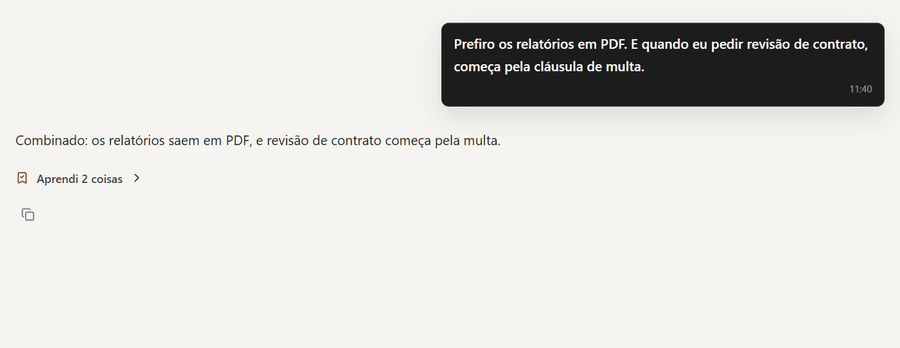</td>
  </tr>
  <tr>
    <td><b>Roda e mostra o que aconteceu.</b> A saída do terminal fica na conversa, com o código de saída.</td>
    <td><b>Mexe no código e mostra o diff.</b> E roda os testes de novo para conferir.</td>
  </tr>
  <tr>
    <td></td>
    <td></td>
  </tr>
  <tr>
    <td><b>Pergunta quando a escolha é sua.</b> Uma pergunta por vez, com opções e resposta livre.</td>
    <td><b>Pede antes do que não volta atrás.</b> Apagar arquivo só oferece "desta vez".</td>
  </tr>
  <tr>
    <td>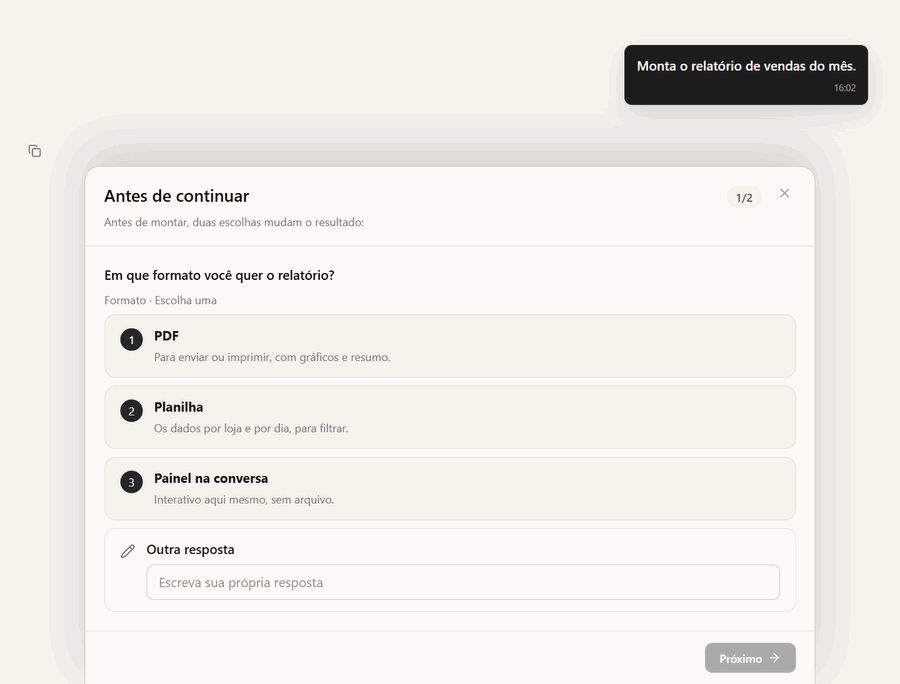</td>
    <td>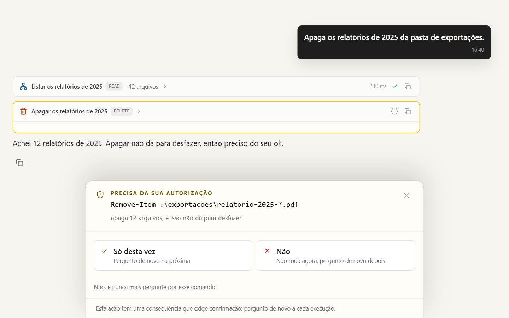</td>
  </tr>
  <tr>
    <td><b>Navega lendo texto.</b> Cada passo no site, com o que ele leu, e zero prints quando o texto basta.</td>
    <td><b>Persegue um objetivo.</b> Com critério de pronto, marcos e limite de turnos, e só começa quando você manda.</td>
  </tr>
  <tr>
    <td></td>
    <td>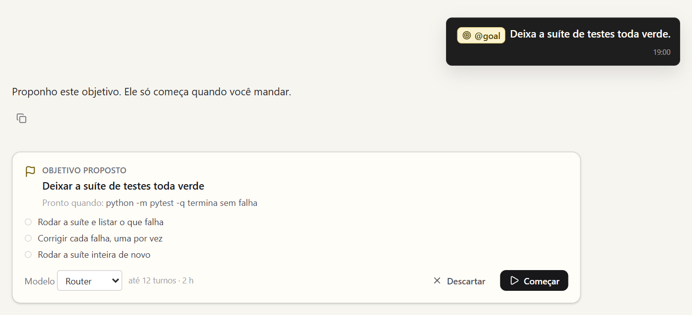</td>
  </tr>
</table>

## Por dentro

O que não aparece na tela é a ordem em que as coisas acontecem. Cada animação
abaixo mostra um mecanismo do Sentury do começo ao fim, e o texto embaixo conta
o que você está vendo. Mais detalhes em [O Sentury por dentro](docs/por-dentro.md).

### O turno

<p align="center">
  
</p>

Você pede algo e um modelo só decide o próximo passo. Cada ferramenta que ele
chama passa antes pela permissão: ler um log segue direto, e o resultado volta
para ele decidir de novo. Quando ele quer mudar um arquivo que você ainda não
autorizou, o turno para num cartão. Você aprova, e ele continua do mesmo passo,
sem precisar pedir de novo. Sem mais nada a fazer, ele responde.

### A ordem da permissão

<p align="center">
  
</p>

Todo comando atravessa oito etapas em fila, e a primeira que tem resposta
decide. A primeira é o que nunca roda: código baixado e executado na hora é
recusado ali, mesmo com "permitir tudo" ligado. Um `npm install` que você
autorizou para sempre passa pelas etapas até encontrar essa autorização. Um
comando que nenhuma etapa conhece vira cartão, e a decisão é sua.

### Hooks

<p align="center">
  
</p>

Pedir no prompt "rode os testes depois de editar" depende de o modelo lembrar,
e é justamente quando ele erra que esquece. Um hook roda porque o evento
aconteceu: o agente editou um `.py`, o hook declarado em `hooks.yaml` dispara a
suíte, o comando passa pela mesma permissão de qualquer outro, e o resultado
("2 falharam") volta para o agente no mesmo turno. Vêm todos desligados.

### A revisão do aprendizado

<p align="center">
  
</p>

Cada ferramenta usada conta uma volta. Na décima, o próprio Sentury revê a
conversa com o mesmo modelo, podendo mexer só em memória e skill. Antes de
gravar, compara com o que já sabe, sem chamar modelo, para não duplicar. Quase
sempre não há nada novo. Quando há, grava (uma preferência na memória, uma
lição numa skill) e mostra embaixo da resposta, com desfazer em cada item.

### Rotas de recuperação

<p align="center">
  
</p>

O modelo tenta um cálculo que precisa de uma biblioteca que o processo isolado
não tem, e o import é negado. Em vez de deixá-lo insistir ou desistir, o
resultado já traz o caminho que funciona: o mesmo código num script que mostra
o conteúdo e pede a sua aprovação. Recusa da política não ganha rota, porque
seria ensinar o modelo a contornar a regra.

### Entregas conferidas

<p align="center">
  
</p>

O relatório, a planilha ou o painel saem do resultado calculado, não do texto
que o modelo escreveu. Antes de chegar a você, o arquivo é conferido: pacote do
Office íntegro, PDF completo, página que abre no navegador. Passou, vira anexo
na conversa e item no painel. Uma página com erro de script volta ao modelo com
o erro do navegador, para ele consertar.

### Setores

<p align="center">
  
</p>

O motor é um só: laço, permissão, memória e ferramentas gerais. Um setor é uma
pasta que diz o que medir, que ferramentas próprias usar, como trabalhar ali e
que servidores trazer. Trocar de setor troca o pacote, não o motor, então um
conserto no motor chega a todos os setores de uma vez.

### A caixa dos residentes

<p align="center">
  
</p>

Você manda uma tarefa a um residente pelo nome, no chat ou no Telegram. Ela
entra na fila dele e o worker o acorda. Ele trabalha numa caixa isolada, sem
dividir disco, processo ou rede com os outros, e a única saída para a internet
é um proxy que só deixa passar os endereços aprovados. Você vê a tela dele ao
vivo e assume o controle quando quiser.

### O ciclo de mutação

<p align="center">
  
</p>

Uma mudança no próprio Sentury nunca começa no código em uso: nasce numa cópia
isolada. Turnos que já aconteceram são repetidos antes e depois da mudança, com
as mesmas respostas do modelo, então a única diferença é a mudança. Promover é
decisão de uma pessoa. Reprovada não é apagada: fica no registro com o motivo,
para ninguém tentar de novo a mesma coisa.

## O que ele faz

### Usa o computador e o navegador como você

Com `@computador` ligado, o Sentury vê a tela e usa o mouse e o teclado para
operar qualquer programa, no Windows e no Linux, sem binário de terceiro. Ele
lê os botões e campos pela acessibilidade do sistema, confere depois de cada
gesto se o que devia acontecer aconteceu e só então segue. Uma moldura acesa
mostra cada gesto e uma frase do que ele vai fazer, e `Ctrl+Alt+Shift+S` para
tudo na hora.

Com `@navegador`, ele abre as próprias abas no seu Chrome, lê a página em texto
antes de olhar o print, lembra o que funcionou em cada site e, quando já sabe o
caminho, roda vários passos de uma vez, parando onde precisa decidir. Na página,
uma seta e um balão anunciam cada ação. Login, senha e código do celular
continuam com você, e enviar, comprar ou se candidatar sempre pergunta antes.
[Navegador e computador](docs/navegador-e-computador.md)

### Trabalho que não cabe num turno

`@plano` mostra o caminho antes de começar e espera o seu ok. `@workflow`
conduz um processo em fases, marca o que terminou e retoma depois, à mão ou num
horário. `@goal` dá a ele um objetivo que persegue turno após turno até um
critério que dá para verificar. Missões guardam cada item de um lote em disco, e
sobrevivem até ao processo morrer no meio. Você manda orientação no meio do
trabalho sem interromper, e quando um passo precisa da sua aprovação, o turno
continua sozinho assim que você aprova. [Conversa e interface](docs/conversa.md)

### Uma equipe que mora na sua máquina

Residentes são colegas que o Sentury cria para trabalhos recorrentes. Cada um
nasce com papel, ferramentas, modelo próprio, rotinas agendadas, limite diário
de uso e uma coruja com a cara dele. Ele dorme até chegar tarefa e espera sem
perder o ponto quando precisa de você. No servidor, cada residente trabalha numa
caixa isolada com rede privada, e você vê a tela dele ao vivo e assume o
controle quando quiser. Pelo Telegram, você chama um residente pelo nome e
aprova pedidos com um botão. [Residentes](docs/residentes.md)

<table>
  <tr>
    <td width="50%"></td>
    <td width="50%"></td>
  </tr>
  <tr>
    <td><b>O Escritório.</b> Uma sala em 3D com quem está livre, trabalhando ou esperando você.</td>
    <td><b>A Mesa.</b> Os residentes discutem um assunto, cada um na sua vez, e fecham com um resumo.</td>
  </tr>
</table>

### Aprende com você, e você vê o que ele aprendeu

O que você ensina vira lembrança num arquivo `.md` que dá para abrir e editar.
O jeito de fazer uma tarefa vira skill, que ele cria e corrige com o que o
trabalho mostrou, comparando antes com as que já existem para não duplicar. De
tempos em tempos ele revê a conversa e decide sozinho se há algo que vale
guardar. Ele vem com skills prontas (relatório em PDF, planilha,
apresentação, diagrama, painel, plano de ação, revisão de PR, conselho de
especialistas) e procura outras no diretório público de skills, instalando só
com a sua aprovação. [Memória e aprendizado](docs/aprendizado.md)

### Pensa junto quando a decisão pesa

Num passo difícil, o próprio modelo pede mais raciocínio. Para uma decisão
grande, o conselho de especialistas olha o problema por três ângulos e fecha
com os prós, os contras e um consenso. Subagentes trabalham em paralelo em
partes do pedido. Se ele mexeu em código e não testou, volta e valida antes de
responder. E quando nota algo que você não perguntou, mas que muda a decisão,
avisa logo abaixo da resposta.

### Fala, escuta e avisa

Uma ligação por voz em tempo real, em que dá para interromper a fala dele e ele
consulta dado real no meio da conversa, e o ditado no campo de mensagem. Pelo
Telegram você conversa, acompanha tarefas e recebe o resultado do que foi
agendado. [Configuração](docs/configuracao.md#voz-e-telegram)

### Você no controle

Leitura segue direto; o que muda algo para num cartão que você aprova uma vez,
na conversa ou sempre. Alguns comandos nunca rodam, nem com "permitir tudo".
Código roda num processo isolado, sem as chaves da máquina, e credencial é
apagada de logs e saídas. Página, arquivo e skill de fora entram como texto de
terceiro, nunca como ordem. Se você cola uma senha ou um cartão na conversa,
ele avisa. Cada arquivo editado guarda a versão anterior.
[Segurança e permissões](docs/seguranca.md)

### Medido, não achado

Cada turno deixa um rastro que dá para inspecionar e repetir. As telas de
traces, uso, evals e diagnósticos mostram o que rodou, quanto custou, que
modelo atendeu e onde falhou. Mudança no comportamento se confere repetindo
turnos gravados, sem tocar no mundo de novo, e uma mudança no próprio Sentury
pode ser testada numa cópia isolada do código antes de valer.
[Observabilidade](docs/observabilidade.md)

### Fácil de mudar, com o modelo que você quiser

Ferramentas, permissões do shell, gatilhos, formatos de entrega, textos que vão
ao modelo e skills moram em arquivos de dado, e os textos se editam pela própria
interface. Um setor especializa o Sentury numa área (engenharia, atendimento)
sem copiar o motor. Setor, skill e servidor MCP entram soltando na pasta.
[Estender o Sentury](docs/estender.md) · [Setores](docs/setores.md).
Num projeto seu, ele lê as instruções de
`Sentury.md`, `CLAUDE.md` ou `AGENTS.md`. O RobinBandit escolhe o modelo entre
as suas contas de Claude, Claude Code, Codex, Gemini, Groq, OpenRouter ou
qualquer serviço compatível com a API da OpenAI, em três modos (Router,
Reforçado, Dedicado). [Modelos](docs/modelos.md) ·
[Onde mora cada coisa](docs/ONDE-MORA-CADA-COISA.md)

Em Runtime, Provedores, Configurar, o botão Continuar com ChatGPT conecta um
plano elegível pelo navegador, sem exigir Codex instalado. Claude Code e Codex
também têm login guiado pelo CLI oficial. Se faltar o executável, a tela indica
como instalar. Desktop não é obrigatório e não é preciso copiar tokens.

## Onde o projeto está

<picture>
  <source media="(prefers-color-scheme: dark)" srcset="docs/assets/progresso-escuro.svg">
  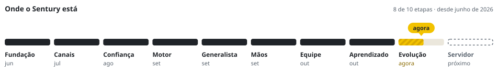
</picture>

| Etapa | Quando | O que entrou |
|---|---|---|
| Fundação | jun 2026 | o laço do agente, conversa, análise de dados com SQL num sandbox, gráficos, memória e as primeiras skills |
| Canais | jul 2026 | Telegram, ligação por voz em tempo real, skills com curador, subagentes, traces e setores plugáveis |
| Confiança | ago 2026 | número da resposta separado em evidência, conta e invenção; texto de terceiro marcado; orçamento por turno; busca em conversas antigas; cofre de chaves e os modos Router, Reforçado e Dedicado |
| Motor | set 2026 | RobinBandit como roteador de modelos; permissão por comando em YAML; gatilhos; repetição de turnos gravados; tool calling nativo; um modelo e um laço como padrão |
| Generalista | set 2026 | trabalho nos arquivos da pessoa com diff; workflow em fases; objetivo perseguido até cumprir; missões que sobrevivem ao processo; instruções do projeto; instalação em um passo com diagnóstico |
| Mãos | set 2026 | navegador com borda, seta e balão; computador com moldura e atalho que para tudo; o Tato como servidor MCP |
| Equipe | out 2026 | residentes com fila e caixa isolada; Escritório em 3D; pedidos entre residentes; Mesa; Telegram com foto, documento e aprovação por botão |
| Aprendizado | out 2026 | memória em arquivos `.md`; revisão que junta skills parecidas; skills de fora com aprovação; painel descrito em dados; ações críticas com aprovação mesmo com tudo liberado; primeiro acesso guiado |
| **Evolução** | **agora** | ciclo de mutação: cópia isolada, repetição de turnos, portões de medição e registro do que foi tentado |
| Servidor | próximo | primeira subida numa VPS e acesso de longe com o Prove2Pass |

Desde junho de 2026, 1.333 commits no repositório de desenvolvimento. Este
repositório é uma cópia limpa dele, com um commit só.

## Em desenvolvimento

O Sentury está em construção ativa. Estas partes já têm código e testes, mas
ainda não foram provadas ponta a ponta:

| Parte | O que já funciona | O que falta |
|---|---|---|
| Ciclo de mutação | cópia isolada, repetição de turnos gravados, portões de medição, registro do que foi tentado e a aba na interface | o próprio Sentury escrever a mudança na cópia, a medição mostrar o progresso ao vivo e o ciclo rodar com os turnos do uso real |
| Residentes no servidor | fila, worker, caixa isolada, Escritório e Mesa, rodando no computador | a primeira subida numa VPS de verdade, com Docker e acesso privado |
| [Prove2Pass](https://github.com/ryanlcruz/Prove2Pass) | o porteiro com senha e segundo fator, em repositório próprio | ligar ao Sentury e testar o acesso de longe |
| Telegram | conversa, anexos e aprovação por botão, com testes | a prova ao vivo num bot de verdade |
| Mesa | os residentes discutem um assunto, cada um na sua vez, e fecham com um resumo | responder mais rápido |
| Modelos locais | qualquer serviço compatível com a API da OpenAI | o teste ao vivo com o LM Studio |

## Começar

Você precisa de Python 3.13 e, para a interface, Node com npm.

```bash
bash scripts/instalar.sh          # Linux/Mac; no Windows: .\scripts\instalar.ps1
python sentury.py                 # interface e API em http://127.0.0.1:8000
```

Copie `.env.example` para `.env` e configure só os provedores que vai usar; uma
conta de modelo basta. Sem conta, a interface abre em modo de demonstração.
`python -m sentury.doctor` confere o que falta na máquina. Instalação à mão e
variáveis: [Configuração](docs/configuracao.md).

## Documentação

| Página | O que cobre |
|---|---|
| [O Sentury por dentro](docs/por-dentro.md) | os mecanismos em animação: turno, permissão, hooks, aprendizado, rotas, entregas, setores, caixa, mutação |
| [Conversa e interface](docs/conversa.md) | o turno, as funções do `@`, os cartões, o painel e o bloco vivo |
| [Ferramentas](docs/ferramentas.md) | arquivos, código, web, comandos, análise, MCP, rotas de recuperação |
| [Entregas e artefatos](docs/entregas.md) | de onde sai o arquivo, o que é conferido, gráficos, a área Artefatos |
| [Navegador e computador](docs/navegador-e-computador.md) | a extensão Tato, a moldura, como ele navega e usa a tela |
| [Memória e aprendizado](docs/aprendizado.md) | memória em arquivos, skills, revisão periódica, skills de fora |
| [Residentes](docs/residentes.md) | colegas persistentes, caixa isolada, Escritório, Mesa, Telegram |
| [Segurança e permissões](docs/seguranca.md) | a ordem da decisão, os cartões, o que nunca roda |
| [Setores](docs/setores.md) | especializar o Sentury numa área sem copiar o motor |
| [Estender o Sentury](docs/estender.md) | os arquivos que mudam o comportamento, hooks, skills, MCP |
| [Observabilidade](docs/observabilidade.md) | traces, uso, evals, diagnósticos, replay, ciclo de mutação |
| [Modelos](docs/modelos.md) | os provedores, o RobinBandit, os modos, o esforço |
| [Configuração](docs/configuracao.md) | instalação, variáveis, voz, Telegram, Atlas |

## Projetos irmãos

| Projeto | O que é |
|---|---|
| [RobinBandit](https://github.com/ryanlcruz/RobinBandit) | o roteador de modelos do Sentury, como projeto próprio |
| [Tato Runtime](https://github.com/ryanlcruz/tato-runtime) | o navegador e o computador do Sentury para outros agentes, por MCP |
| [Prove2Pass](https://github.com/ryanlcruz/Prove2Pass) | porteiro com senha e segundo fator para acessar o Sentury de longe |

## Licença

MIT. Veja [LICENSE](LICENSE). Uma skill trazida de outro projeto mantém a
própria licença, indicada no `ATTRIBUTION.md` da pasta dela.
