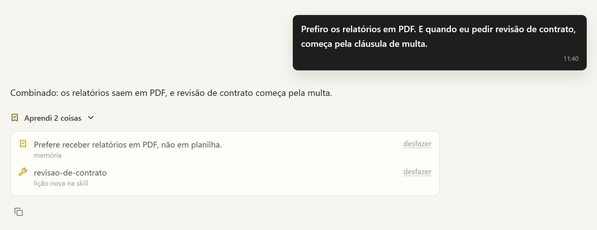

# Memória e aprendizado

O Sentury guarda o que aprende em arquivos na sua máquina, em `~/.sentury/`
(ou na pasta de `SENTURY_HOME`). Dá para abrir, ler e editar com qualquer
editor.

## Memória

Cada lembrança é um arquivo `.md` em `~/.sentury/memoria/<usuário>/`, com um
tipo:

| Tipo | Para quê |
|---|---|
| `pessoa` | quem você é, como prefere trabalhar |
| `decisao` | uma escolha feita, com o motivo |
| `projeto` | o que está em andamento e por quê |
| `referencia` | onde achar algo de fora |

O índice `MEMORIA.md` lista uma linha por lembrança. O modelo usa a ferramenta
`memoria` para salvar, ler, listar e esquecer. Antes de salvar, o Sentury
procura uma lembrança parecida e devolve o nome dela, para o modelo atualizar
em vez de duplicar. Memória não expira; você revisa e apaga pela tela de
memória ou pedindo na conversa.

## Skills

Skill é um procedimento reutilizável: como fazer uma classe de tarefa, com os
passos e as armadilhas. É uma pasta com um `SKILL.md` e, quando precisa,
`scripts/`, `references/`, `templates/` e `assets/`. As que vêm com o Sentury
moram em `sentury/skills/`; as suas moram em `~/.sentury/skills/` e valem sobre
as embutidas.

O modelo carrega uma skill com `executar_skill` quando o pedido combina com
ela. Carregar não executa nada: um script da skill só roda por
`executar_script`, com a aprovação de sempre.

### As que vêm com o Sentury

| Grupo | Skills |
|---|---|
| Raciocínio | conselho de especialistas (`llm-council`), plano de ação, montar spec, montar workflow, painel sob medida, executar no terminal, DMAIC, Ishikawa |
| Criação | bloco vivo, diagramas de conceito, Excalidraw, design de interface, design de front-end, gráfico, construtor de visualização, meme, arte ASCII |
| Documentos | relatório em PDF, PDF, planilha, apresentação |
| Dados e código | kernel Jupyter ao vivo, validação de consulta, fluxo de pull request no GitHub |
| Pesquisa e mídia | arXiv, busca de GIF |

### O que o Sentury aprende sozinho

A ferramenta `aprender_skill` cria ou corrige uma skill sua com o que o
trabalho ensinou:

| Ação | O que faz |
|---|---|
| `criar` | skill nova; avisa se já existe uma parecida |
| `acrescentar` | põe uma lição no fim ou sob uma seção |
| `corrigir` | troca um trecho exato que estava errado |
| `anexar` | guarda um script ou referência junto da skill |
| `aposentar` | tira de uso uma skill que sobrou |
| `desfazer` | volta a última escrita, inclusive trazer de volta uma aposentada |

Skill embutida não muda no lugar: a primeira escrita faz uma cópia sua, e a
cópia passa a valer.

### A revisão a cada N voltas

De tempos em tempos o Sentury revê a conversa e decide se há algo para guardar.
Na maioria das vezes não há, e ele não grava nada. A revisão usa o mesmo modelo
e só pode mexer em memória e skills.

Ela acontece a cada `SENTURY_APRENDER_A_CADA` voltas (padrão 10): cada
ferramenta usada conta uma volta, e um turno só de conversa conta uma. O número
e o liga e desliga (`SENTURY_AUTOLEARN`) também estão na tela de Configurações.
Quando duas skills suas tratam da mesma tarefa, a revisão recebe o texto das
duas e pode juntá-las, aposentando a que sobrou.

Quando um turno guarda algo, a resposta mostra "Aprendi uma coisa" ou "Aprendi N
coisas" embaixo dela. Abre num clique e lista cada lembrança e cada skill
mexida, com desfazer.

  

### Como a revisão decide

| | O que acontece |
|---|---|
| Quando revisa | depois de uma contagem de turnos, ajustável na tela |
| Quem pode gravar | propriedade de cada ferramenta no `tools.yaml` |
| Antes de criar | compara com as skills parecidas, sem chamar modelo |
| Skill embutida | vira uma cópia sua, com histórico e desfazer |
| Memória | um `.md` por lembrança, com tipo e índice |

## Skills de fora

A ferramenta `find_skills` procura skills públicas de outras pessoas no
diretório [skills.sh](https://skills.sh). `buscar` traz nome, repositório e
número de instalações. `ver` lê a skill no GitHub, presa num commit, e mostra o
texto, a licença, os arquivos, os scripts e as skills parecidas que já existem,
sem gravar nada. `instalar` sempre pede a sua aprovação, mesmo com "permitir
tudo"; o cartão mostra de onde vem, a licença e os scripts, e a aprovação vale
só para aquela skill naquele commit.

A skill instalada guarda origem, commit e licença no cabeçalho. Ela não se
ativa sozinha por palavra, nunca roda comando ao ser carregada e entra no
contexto com o aviso de que foi escrita por terceiro. Só arquivos de texto são
copiados, com limite de tamanho. `aprender_skill` com `desfazer` remove a
instalação.

## Conhecimento e conversas anteriores

`buscar_conhecimento` consulta o manual do Sentury, com o uso de cada
ferramenta e skill. `buscar_conversas` procura o que já foi conversado com você
em outras sessões. Embeddings locais (`SENTURY_EMBEDDINGS`) ou do Gemini
(`SENTURY_GEMINI_EMBEDDINGS`) melhoram a busca; sem eles, a busca é por texto.
