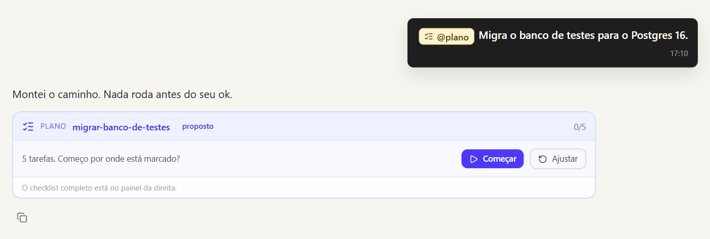
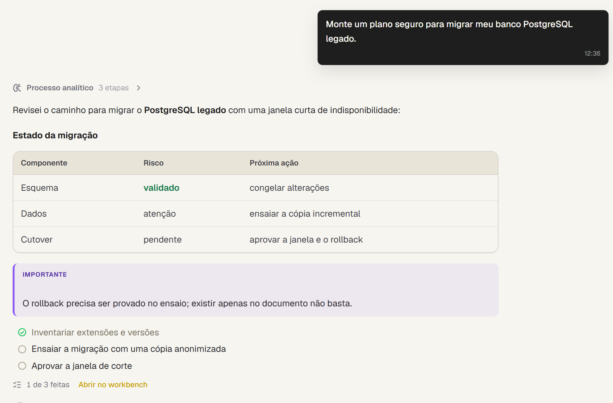
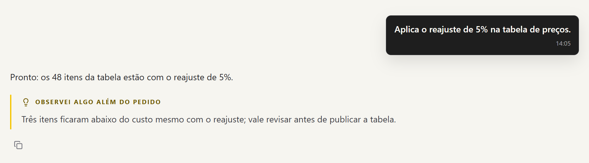
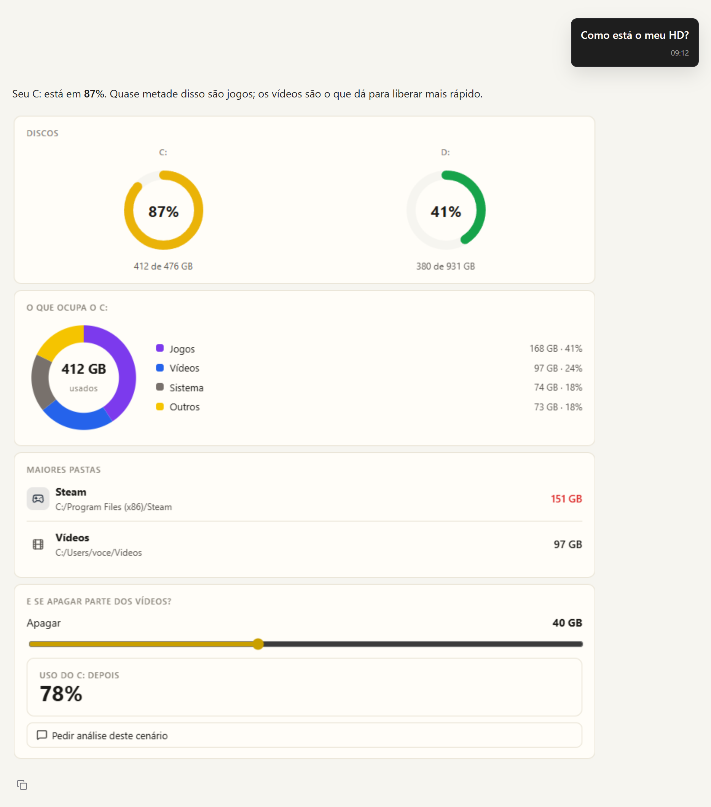
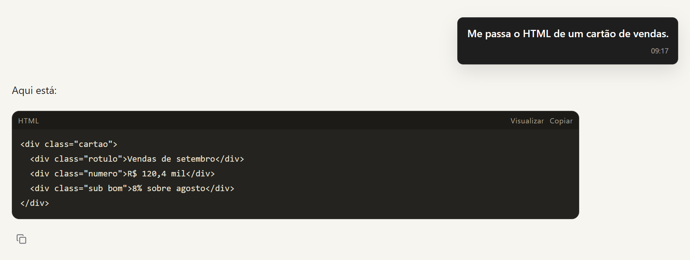
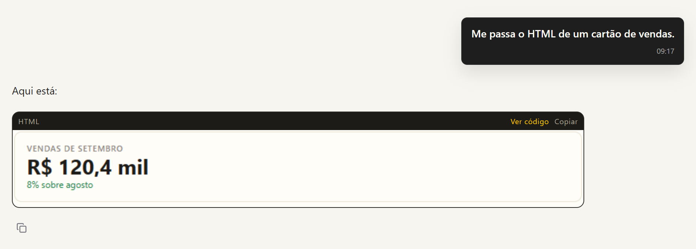

# Conversa e interface

A interface abre em `http://127.0.0.1:8000` depois de `python sentury.py`. Tudo
acontece numa conversa: você pede, o Sentury usa as ferramentas que precisar e
responde no mesmo lugar.

## O turno

Cada mensagem vira um turno. Um modelo só decide o próximo passo, chama as
ferramentas que precisar e escreve a resposta. O Sentury não classifica o
pedido antes do modelo: saudação, pergunta e tarefa longa passam pelo mesmo
caminho, em qualquer língua e com qualquer grafia.

Durante o turno você vê cada passo. No topo fica a ferramenta que está rodando
e, ao lado, o que ela está fazendo em palavras; embaixo, a lista dos passos, com
o que deu certo, o que foi contornado e o que ainda roda. O raciocínio do
modelo não ocupa a tela durante o trabalho: ele fica no "Processo analítico",
que abre depois da resposta.

  

Quando um comando roda, a saída do terminal aparece no próprio passo. Quando um
arquivo muda, o passo mostra o diff, com as linhas que entraram e saíram.

### Enquanto ele trabalha

Dá para mandar uma orientação no meio do turno ("usa a pasta de testes, não a
de produção"): ela entra no próximo ponto seguro, sem interromper o que está
rodando, e se chegar quando a resposta já está sendo escrita, vira o turno
seguinte. Para parar tudo, use o botão de parar ou `Ctrl+Alt+Shift+S` de
qualquer lugar; a parada pedida no chat espera uma escrita em andamento
terminar, para não deixar arquivo pela metade.

Se a conexão cai, a tela volta de onde parou, porque cada evento do turno é
numerado. Se o pedido ficou grande demais para o provedor, o Sentury compacta
a conversa e tenta de novo. Se o turno mexeu em código e não rodou nada para
conferir, ele volta e valida antes de responder.

Uma chamada repetida com os mesmos argumentos não roda de novo: o modelo recebe
o resultado anterior e um aviso para mudar de caminho. Um arquivo citado na
resposta que não existe volta ao agente em vez de virar entrega.

Arquivo que você anexa no chat entra no turno já lido, e imagem anexada vai ao
modelo que enxerga sem pesar no histórico.

## Funções do `@`

Digite `@` no campo de mensagem para ligar uma função. Ela fica ligada até você
desligar, em vez de depender de o texto ter a palavra certa toda vez.

| Função | O que liga |
|---|---|
| `@plano` | mostra o caminho de um trabalho com vários passos e espera o seu ok antes de executar |
| `@workflow` | conduz um processo em fases até fechar, marca o que terminou e retoma depois, à mão ou num horário |
| `@goal` | um objetivo que o Sentury persegue turno após turno até um critério verificável; ele propõe e você aprova no cartão |
| `@image` | permite gerar imagem; sem ela, pedido de "visual" vira gráfico de dados |
| `@computador` | libera a tela, o mouse e o teclado nesta conversa; cada gesto pede aprovação |
| `@navegador` | libera abrir e operar páginas; o que envia dado ou fala em seu nome pede aprovação |

## Esforço

A barra de esforço define quanto o modelo raciocina: Leve (`low`), Médio
(`medium`) ou Profundo (`high`). Em Automático, o provedor usa o padrão dele.
O Sentury não escolhe o esforço lendo a mensagem, e o esforço vale para o
turno inteiro.

## Cartões

O que precisa de você aparece como cartão na conversa.

| Cartão | Quando aparece |
|---|---|
| Permissão | uma ação que muda algo e ainda não foi autorizada; você permite uma vez, nesta conversa ou sempre, ou nega. Ação que apaga ou não dá para desfazer só oferece "desta vez". Veja [Segurança](seguranca.md) |
| Pergunta | o modelo precisa de uma informação que só você tem, e a escolha muda o próximo passo |
| Plano | um trabalho com vários passos para você aprovar antes de executar |
| Objetivo | o `@goal`: nada roda antes do seu "Começar"; você pausa e continua quando quiser, e a palavra final sobre se ele cumpriu é sua |

Aprovou, o turno continua sozinho do passo em que parou, com os mesmos
argumentos que você viu.

  
  

  
  

  

## Embaixo da resposta

Ficam os sinais do que o turno fez além de responder: a skill usada, a análise
aprofundada, o trabalho em paralelo dos subagentes e o conselho de
especialistas, cada um recolhido até você abrir.

O que ele guardou aparece em "Aprendi uma coisa" ou "Aprendi N coisas". Abre
num clique, com cada lembrança e cada skill mexida, e um desfazer em cada item.

  

Quando nota algo que você não pediu e que muda a decisão, ele avisa logo abaixo.

  

## Conselho e subagentes

Para uma decisão grande, a skill `llm-council` reúne um conselho de
especialistas: o problema é visto por três ângulos, e a resposta fecha com os
prós, os contras e um consenso. O conselho só roda sobre dado de verdade da
conversa; sem dado, ele busca primeiro. Subagentes trabalham em paralelo em
partes do pedido e devolvem um resumo cada um, sem receber o histórico da
conversa.

## Respostas que desenham

Além de texto, tabela e diagrama, a resposta pode trazer um quadro interativo,
desenhado com o visual do Sentury.

O **painel** (bloco `painel`) é o modelo descrevendo em JSON o que mostrar: há
números, tabela, barras, medidor, rosca, linha, progresso, lista, simulador
com controle deslizante, aviso, passos e texto. O modelo escolhe as cores, por
nome (`verde`, `vermelho`, `azul`) ou em hex.

Num item de lista, progresso ou barras, `"app": "steam"` põe o ícone e a cor do
programa. O Sentury tem uma tabela própria de programas
(`sentury/client/src/domain/blocoVivo/apps.json`); programa fora dela ganha a
inicial numa cor fixa. Funciona igual em Linux e Windows.

O **bloco vivo** (bloco `vivo`) é HTML ou SVG escrito pelo modelo, com os
ícones e as classes do kit do Sentury. Script roda, então simulador, abas e
calculadora funcionam.

  
  

Os dois rodam isolados da página: não leem cookie, não falam com a rede e não
alcançam o resto da interface. Um botão dentro do quadro pode propor uma
mensagem; ela só vai depois que você confirma.

Código que você pediu continua sendo código. Um bloco `html` ou `svg` aparece
para ler e copiar, com o botão **Visualizar** para ver desenhado no mesmo
quadro isolado.

  
  

Os números do quadro passam pela mesma conferência dos números do texto: valor
sem origem nos resultados das ferramentas ganha aviso. A skill `bloco-vivo`
(`sentury/skills/creative/bloco-vivo/SKILL.md`) é o que ensina o modelo a usar
tudo isso.

## Pasta do projeto

A pasta ativa aparece junto ao campo de mensagem e diz onde o Sentury lê e
escreve. Quando ele toca uma pasta, lê as instruções que você deixou nela, no
primeiro arquivo que existir entre `Sentury.md`, `CLAUDE.md` e `AGENTS.md`, da
pasta mais de fora para a mais de dentro. A instrução não libera nada que a
permissão proíbe.

## Contexto e dado sensível

O medidor de contexto, ao lado do campo, mostra quanto da janela do modelo a
conversa já usa e quanto da última chamada veio do cache do provedor. Quando a
conversa cresce demais, o Sentury grava um resumo e compacta, e a conversa
segue.

Quem faz esse resumo é escolha sua, em Configurações, Memória e contexto. O
padrão é o modelo da conversa, que entende o histórico como ele foi. A outra
opção é um modelo auxiliar, mais barato, que também dá o título da conversa e
resume página longa da pesquisa: ele usa a rota `auxiliar` do YAML do
RobinBandit quando ela existe e, sem ela, o Router, sem a conta do Reforçado
nem a do Dedicado.

Se você colar uma senha, uma chave, um CPF ou um número de cartão válido, ele
avisa uma vez que aquilo é sensível e segue com o que você pediu. Ele não apaga
nem troca o valor.

## Comandos de barra

Digitados no chat, rodam direto, sem chamar o modelo.

| Comando | O que faz |
|---|---|
| `/skills` | lista as skills disponíveis |
| `/learn <nome>: <texto>` | grava o texto como uma skill sua com esse nome (`/learn revisao-de-contrato: começar pela multa`), comparando antes com as parecidas; dá para desfazer |
| `/curator` | arquiva as skills suas que estão paradas há muito tempo |

## Áreas da interface

| Área | O que tem |
|---|---|
| Trabalho | planos, workflows, missões, objetivos e agendamentos |
| Artefatos | as entregas do Sentury: relatórios, planilhas, páginas |
| Conhecimento | memória, skills, setores e os textos que vão ao modelo |
| Residentes | o HQ, o Escritório e a Mesa; veja [Residentes](residentes.md) |
| Observabilidade | traces, uso, evals e diagnósticos; veja [Observabilidade](observabilidade.md) |
| Ajuda | a documentação de uso dentro da própria interface |
| Configurações | contas e modos de modelo, permissões, aprendizado, embeddings e canais |
