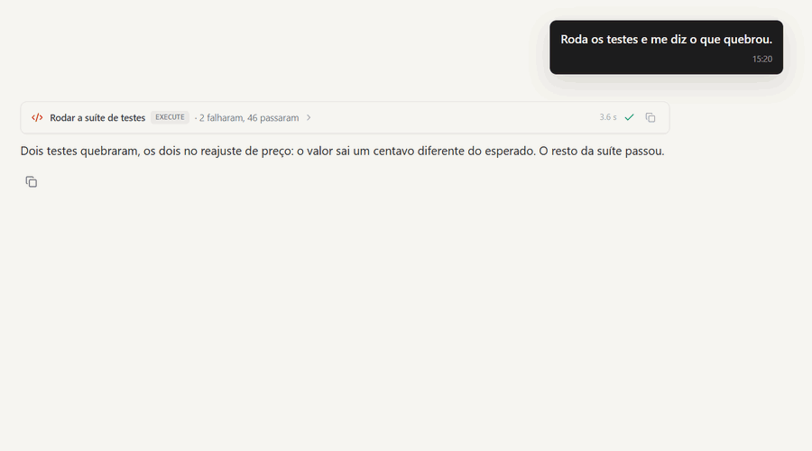
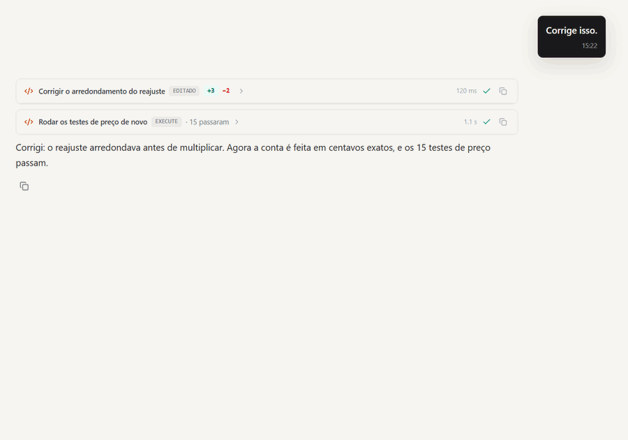
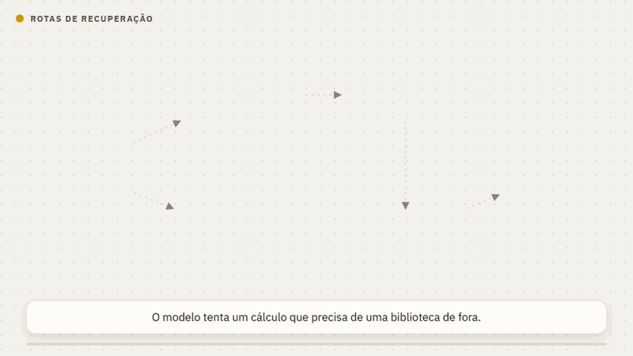

# Ferramentas

O modelo escolhe as ferramentas conforme o pedido. Com tool calling nativo, quando o catálogo inteiro
cabe no teto de tokens (`SENTURY_FERRAMENTAS_TETO_TOKENS`, padrão 20 mil, perto
de 10% de uma janela de 200 mil), ele recebe todas em cada chamada. Acima do
teto, chegam as do núcleo, as que combinam com o pedido e um mapa do resto:
`search_tools` mostra os parâmetros de uma que ficou de fora, e `usar_ferramenta`
a chama pelo nome na mesma resposta. Essa chamada passa pela mesma permissão que
a ferramenta teria direto. Se o modelo recusar o pedido por tamanho, o turno
passa a esse modo antes de compactar a conversa.

Toda ferramenta é declarada em `sentury/tools/tools.yaml`: nome, descrição,
orientação ao modelo, parâmetros e efeito (`leitura`, `escrita` ou
`destrutiva`). O efeito decide se ela pede permissão. Veja
[Segurança](seguranca.md).

## Arquivos e código

| Ferramenta | O que faz |
|---|---|
| `listar_arquivos`, `ler_arquivo` | veem pastas e arquivos do projeto, um trecho por vez |
| `escrever_arquivo`, `editar_arquivo` | criam ou trocam um trecho exato; pedem autorização |
| `historico_do_arquivo`, `restaurar_versao` | mostram as versões anteriores de um arquivo e voltam uma delas |
| `codigo` | lê a estrutura de código Python: o que um arquivo tem, onde algo é definido, quem chama uma função |
| `diagnosticos` | acha erro de sintaxe, import ausente e nome solto sem rodar nada |
| `entregar_arquivo` | anexa um arquivo na conversa para você baixar |

Toda escrita guarda a versão anterior, então dá para ver o que mudou e desfazer.
Na conversa, cada edição abre como diff, e cada comando mostra a saída do
terminal com o código de saída.

<p align="center">
  
  
</p>

## Comandos e scripts

| Ferramenta | O que faz |
|---|---|
| `executar_comando` | uma linha de shell (bash ou PowerShell); leitura roda direto, o que altera pede aprovação |
| `executar_script` | um script de várias linhas (PowerShell, bash, Python, Node) ou um auxiliar de skill; a aprovação vale para aquele conteúdo |
| `processos` | lista, lê ou encerra os comandos que rodam em segundo plano |
| `checar_pacote` | consulta a base de vulnerabilidades antes de instalar um pacote: malware bloqueia, falha conhecida avisa |
| `inspecionar_ambiente` | lê processos, janelas, portas locais, disco e sistema, sem aceitar comando livre |

O que o shell pode rodar e o que nunca roda mora em `sentury/policies/shell.yaml`.

O Python roda num processo filho já aquecido, que só alcança o Sentury por uma
porta local com token. Esse processo recebe um ambiente limpo, sem as chaves da
máquina, e a saída passa por uma redação que esconde credencial antes de chegar
à conversa ou ao log. Cada ferramenta tem um prazo; o processo que passa dele é
encerrado de verdade, e comando demorado pode seguir em segundo plano enquanto
o turno continua. Quando um caminho não existe, a resposta traz o que existe ao
lado.

Um comando também pode rodar sozinho depois de uma ferramenta, por um hook
(por exemplo, a suíte de testes depois de editar um `.py`). Veja
[Estender o Sentury](estender.md#hooks).

### Quando uma execução falha

Algumas falhas têm um caminho conhecido, e o resultado da ferramenta já traz
esse caminho para o modelo não insistir no mesmo erro nem desistir respondendo
só em texto:

| Falha | Caminho que o modelo recebe |
|---|---|
| `executar_python` recusa um import que não cabe no processo isolado | o mesmo código em `executar_script` com Python, que mostra o conteúdo e pede a sua aprovação |
| `executar_python` passa do tempo | `executar_script` com prazo explícito e o trabalho dividido em partes menores |
| `executar_comando` recebe pipe ou redirecionamento | `executar_script` em PowerShell (Windows) ou bash, com o corpo inteiro |

Recusa da política (o que nunca roda, ou o que você negou) não ganha caminho
alternativo: seria ensinar o modelo a contornar a regra. Quando o modelo segue
a rota e ela funciona, o turno registra a troca de caminho na telemetria. As
rotas moram em `sentury/policies/rotas.yaml`; uma nova é uma entrada a mais.

<p align="center">
  
</p>

## Web

| Ferramenta | O que faz |
|---|---|
| `buscar_web` | busca e lê as melhores fontes |
| `ler_pagina` | lê o texto de uma página pública, uma parte por vez, com os links numerados |
| `browser` | opera uma página num navegador de verdade: clicar, preencher, rolar |

O navegador abre também endereço local (`localhost`, rede de casa), para validar a
página que você está desenvolvendo. A `ler_pagina` lê endereço local na instalação
local; quando o Sentury roda como servidor (a HQ), ela o recusa, inclusive no meio de
um redirecionamento. Veja [Segurança](seguranca.md#rede).

## Análise e entregas

| Ferramenta | O que faz |
|---|---|
| `executar_python` | Python com pandas, numpy e matplotlib, num processo isolado; o que o script grava chega como anexo |
| `generate_chart` | gráfico em PNG de um resultado já calculado |
| `export_pdf`, `export_xlsx`, `export_csv`, `export_html` | relatório, planilha, tabela ou painel HTML de um resultado |
| `gerar_imagem` | imagem a partir de texto, com `@image` no pedido e um modelo de imagem configurado |

Número que aparece numa entrega precisa ter vindo de uma ferramenta desta
conversa. Valor sem origem ganha aviso. De onde o arquivo sai e o que é
conferido antes de ele chegar está em [Entregas e artefatos](entregas.md).

## Trabalho que atravessa turnos

| Ferramenta | O que faz |
|---|---|
| `criar_plano`, `ver_plano`, `status_da_tarefa` | o plano de um trabalho longo em disco: por que ele existe e o checklist do que falta |
| `criar_workflow`, `ver_workflow` | uma rotina guardada, para disparar à mão ou num horário |
| `agenda` | agenda uma tarefa simples para depois, lista e cancela |
| `missao` | um lote de itens que sobrevive entre turnos: cada item abre antes de agir e fecha com evidência |
| `goal` | um objetivo da conversa que o Sentury persegue turno após turno até um critério verificável |
| `perguntar_usuario` | pergunta e espera, quando a sua escolha muda o próximo passo |

Agendamento e sessão moram no disco local; não há serviço externo de fila.

## Memória, skills e conhecimento

`memoria`, `aprender_skill`, `find_skills`, `executar_skill`,
`buscar_conhecimento`, `buscar_conversas`: veja
[Memória e aprendizado](aprendizado.md).

## Residentes

`criar_agente`, `pedir_ao_agente`, `abrir_assunto`, `falar_na_mesa`: veja
[Residentes](residentes.md).

## Ferramentas suas (MCP)

Para dar ao Sentury ferramentas de outro serviço, conecte um servidor MCP em
`~/.sentury/mcp.json`:

```json
{"servidores": [
  {"nome": "meu-servidor", "transporte": "stdio", "comando": "npx",
   "args": ["-y", "pacote-do-servidor"], "env_vars": ["CHAVE_DO_SERVICO"]}
]}
```

O arquivo guarda só o nome da variável de ambiente, nunca o valor. Servidor
remoto usa `"transporte": "http"` e `"url"`. O modelo chama as ferramentas dele
por `usar_mcp`, com a mesma permissão das outras.
