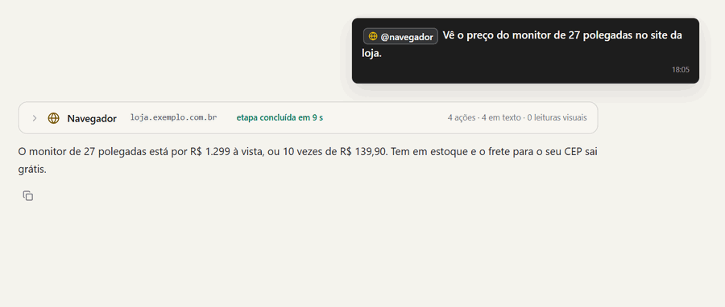
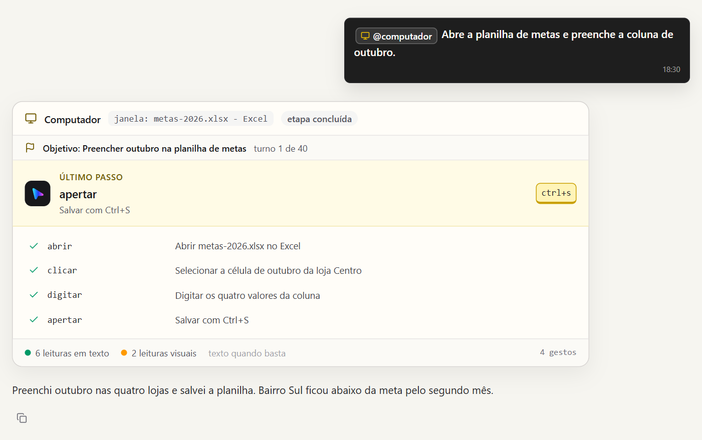

# Navegador e computador

## O seu Chrome, pela extensão Tato

O navegador do Sentury é o seu Chrome, por meio da extensão Tato. Ele abre e
opera as próprias abas e não assume as que você já tinha abertas. Lê a página
em texto antes de pedir imagem, segue links e preenche controles. A sessão
continua disponível para a próxima orientação, até você encerrar.

Para instalar a extensão, veja [o README dela](../sentury/browser_extension/README.md).

### Como ele navega

Ler a página em texto vem primeiro, porque é barato e exato; o navegador de
verdade e o print só entram quando o texto não basta. O Sentury lembra, por
site, o que funcionou da última vez, então a segunda página do mesmo site não
paga a escada inteira de novo. Para uma lista de links sem abrir navegador
nenhum, ele numera os links da página e segue pelo número.

Quando já sabe a sequência, ele escreve um roteiro: vários passos numa chamada
só (clicar, digitar, esperar), com conferências no meio ("depois disso deve
aparecer o carrinho"). Se uma conferência falha, o roteiro para ali e devolve o
que encontrou, em vez de seguir clicando às cegas.

Com a janela do navegador na sua frente, cada ação vem anunciada dentro da
página: uma borda colorida, uma seta própria que anda até o alvo e um balão com
o que vai acontecer. Você escolhe em Configurações qual perfil do Chrome o
agente usa.

Na conversa, um cartão resume a etapa: cada passo no site, o que ele leu ali e
quantas leituras foram em texto e quantas em imagem.

  

## O computador

A ferramenta `computador` vê a tela e usa o mouse e o teclado quando a tarefa
exige um programa. O Sentury procura primeiro o que o sistema descreve em texto
e usa a imagem quando precisa.

Enquanto o Sentury usa a máquina, uma moldura acesa mostra cada gesto e uma
frase curta do que ele vai fazer, e uma seta marca onde está o cursor dele.
`Ctrl+Alt+Shift+S` interrompe tudo na hora, e você pode assumir o controle a
qualquer momento. Ligar o `@computador` na conversa é a aprovação: os gestos
rodam sem cartão até você desligar. Só digitar e-mail ou outro dado pessoal
pede confirmação, a cada vez.

  

### Por dentro

No Windows, o Sentury lê os botões, campos e links pela UI Automation e move o
mouse e o teclado pelas próprias chamadas do sistema, sem binário de terceiro.
No Linux, usa o X11 para os gestos e o AT-SPI para os elementos. Ele também sabe
que programas estão rodando e quais estão instalados.

Depois de cada gesto, ele confere pela acessibilidade se o que devia acontecer
aconteceu, se algo mudou ou se nada mudou, e só então decide o próximo. Isso
evita repetir um clique que já funcionou e abrir a mesma janela duas vezes.

Um computador tem um agente por vez, e a vez pode ser sua: quando você mexe, ele
espera. Se o modelo da conversa não enxerga imagem, um modelo de visão descreve
o print em texto, e a conversa segue com o mesmo modelo.

## O que fica com você

O agente não digita senha e não resolve login: código que chega no seu
celular e entrada em conta são seus, e ele passa a vez. Enviar, publicar,
comprar ou se candidatar pede confirmação antes.

## O navegador que o Sentury abre sozinho

Para verificar se uma página gerada renderiza, e no provedor de navegador por
Playwright, o Sentury abre um navegador sem tela. Ele prefere o Google Chrome
instalado e, sem ele, o Microsoft Edge, sempre com perfil temporário, nunca o
seu. Sem nenhum dos dois (um servidor Linux, por exemplo), usa o Chromium do
Playwright. Por isso o instalador só baixa o Chromium quando não acha o Chrome
nem o Edge.

A variável `SENTURY_NAVEGADOR_CANAL` troca a escolha: `chrome`, `msedge` ou
`chromium`. No Windows com Controle Inteligente de Aplicativos ligado, o
Chromium do Playwright é bloqueado; o Chrome instalado não.

## Para outros agentes

O [Tato Runtime](https://github.com/ryanlcruz/tato-runtime) oferece o mesmo
navegador e computador a outros agentes por MCP, com as mesmas regras de
moldura, interrupção e aprovação.
