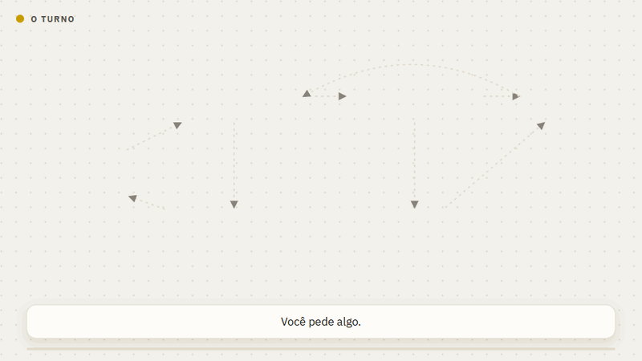
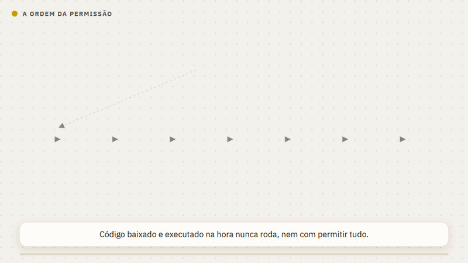
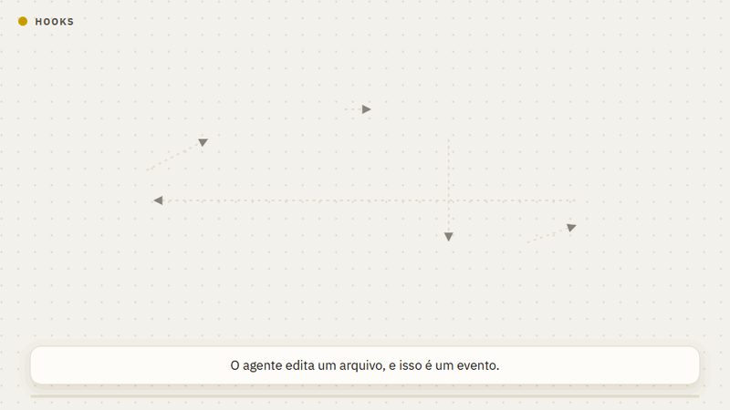
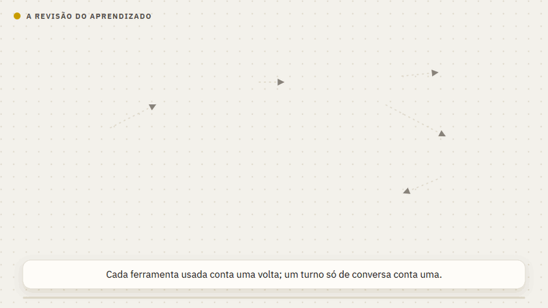
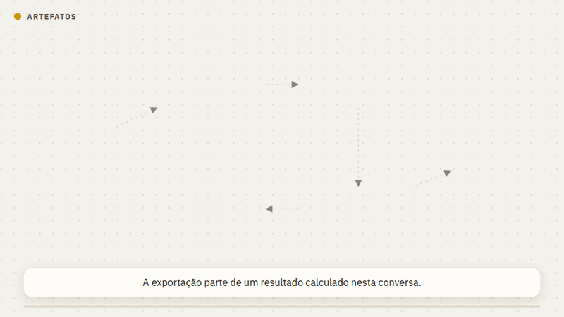
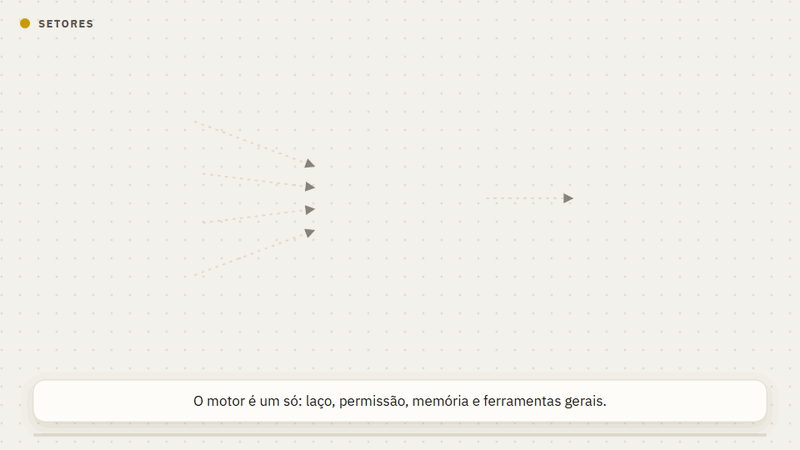
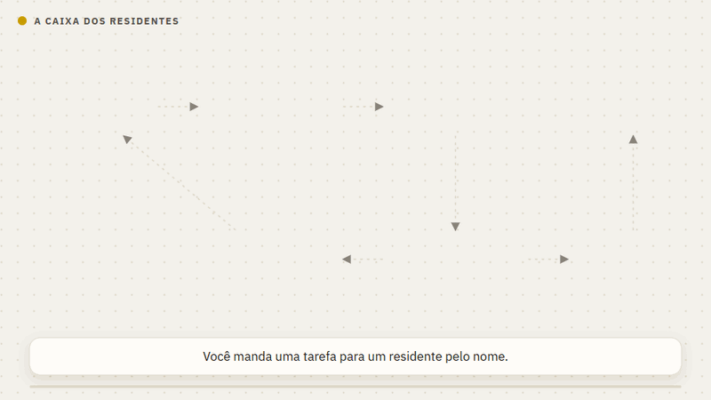
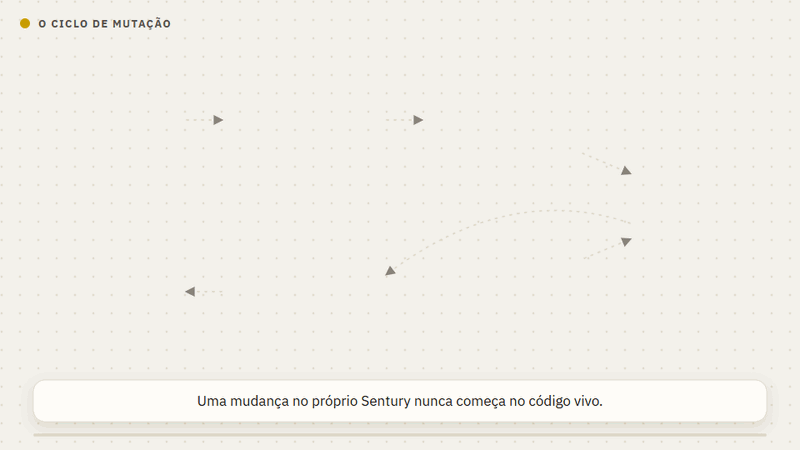

# O Sentury por dentro

Boa parte do que o Sentury faz não aparece na tela: é a ordem em que as coisas
acontecem dentro de um turno. Esta página mostra cada mecanismo em movimento e
aponta onde ele está explicado em detalhe.

## O turno

  

Um modelo só decide o próximo passo e chama ferramentas. Toda chamada passa
pela permissão antes de rodar: leitura segue direto, escrita que você ainda não
autorizou vira um cartão. Quando você aprova, o turno continua do mesmo passo,
sem o modelo precisar pedir de novo. Veja [Conversa e interface](conversa.md).

## A ordem da permissão

  

Oito etapas, e a primeira que responde decide. O que nunca roda (código
baixado e executado na hora, tomada de privilégio, destruir a máquina) é
recusado antes de qualquer outra, inclusive com "permitir tudo" ligado. Veja
[Segurança e permissões](seguranca.md).

## Hooks

  

Uma instrução no prompt é um pedido que o modelo pode esquecer. Um hook roda
porque o evento aconteceu: o agente editou um `.py`, a suíte roda, e o
resultado volta para ele ler no mesmo turno. Veja [Estender o Sentury](estender.md#hooks).

## A revisão do aprendizado

  

A cada dez voltas o próprio Sentury revê a conversa, com o mesmo modelo e só
com as ferramentas de memória e skill. Antes de gravar, compara com o que já
existe sem chamar modelo. Quase sempre não há nada novo; quando há, aparece
embaixo da resposta com desfazer. Veja [Memória e aprendizado](aprendizado.md).

## Rotas de recuperação

  

Quando uma ferramenta falha de um jeito conhecido, o resultado já traz o
caminho que funciona, para o modelo não insistir no mesmo erro nem desistir
respondendo só em texto. Recusa da política não ganha desvio. Veja
[Ferramentas](ferramentas.md#quando-uma-execução-falha).

## Entregas

  

Relatório, planilha e painel saem do resultado calculado, não do texto que o
modelo escreveu. Antes de chegar a você, o arquivo é conferido: pacote do
Office íntegro, PDF completo, página que abre no navegador. Veja
[Entregas e artefatos](entregas.md).

## Setores

  

O motor é um só. Um setor é uma pasta que diz o que medir, como falar, que
ferramentas próprias usar e como trabalhar naquela área. Trocar de setor troca
o pacote, não o motor. Veja [Setores](setores.md).

## A caixa dos residentes

  

Cada residente trabalha numa caixa própria, sem dividir disco, processo ou rede
com os outros. A única saída da caixa para a internet é um proxy que só deixa
passar os endereços aprovados. Veja [Residentes](residentes.md).

## O ciclo de mutação

  

Uma mudança no próprio Sentury nasce numa cópia isolada do código, é comparada
com turnos que já aconteceram e só entra com a decisão de uma pessoa. Veja
[Observabilidade](observabilidade.md#ciclo-de-mutação).
