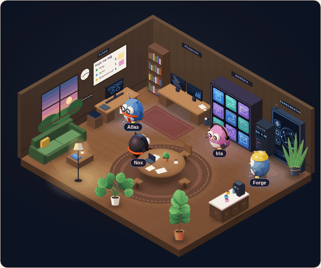
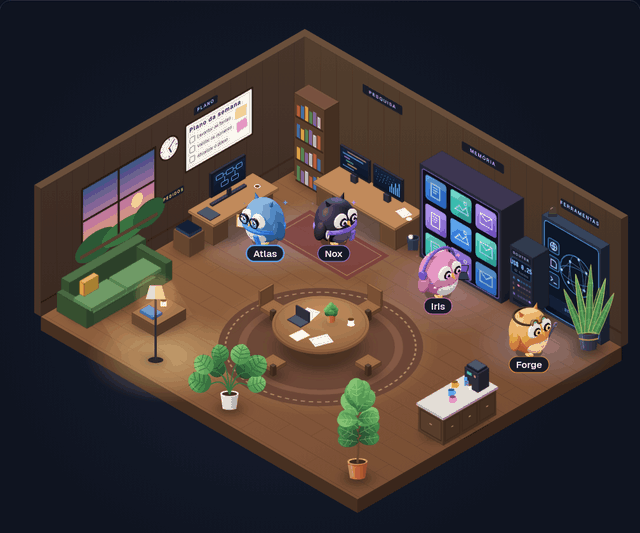

# Residentes

<p align="center">
  
</p>

Residentes são colegas persistentes que o Sentury cria para trabalhos
recorrentes. Você define o papel e o objetivo; cada residente recebe um
conjunto de ferramentas e um limite diário de uso. Ele dorme até chegar uma
tarefa, trabalha nela e devolve a resposta. Se precisar da sua aprovação,
espera sem perder o ponto em que parou.

## Nascer, trabalhar, pedir

Peça no chat para o Sentury criar um residente. O cartão de aprovação já mostra
a coruja que vai nascer, com o nome, o papel e as ferramentas, e ela aparece no
HQ assim que você aprova. Depois, mande tarefas pelo chat ou chame o residente
pelo nome, inclusive pelo Telegram.

Cada residente tem um modelo próprio: você escolhe o provedor e o modelo dele,
ou deixa vazio para o RobinBandit escolher a cada tarefa. Ele também tem
memória própria, que leva de uma tarefa para a outra, e rotinas agendadas por
dia e horário.

Se o modelo do residente cair, ele faz o que você escolheu: para a tarefa, ou
devolve ao RobinBandit para outro modelo continuar.

Cada coruja nasce do nome: a plumagem e um acessório saem dele, então cada
residente tem a sua cara, e o papel entra como um objeto que ele carrega. Você
troca os acessórios quando quiser e pode voltar aos que o Sentury escolheu.

O Sentury também pode dar skills ao residente. Elas entram carregadas em toda
tarefa dele, e aparecem primeiro quando você digita `/` no chat dele.

## Falar com eles

Começar a mensagem com `@alfa` manda a tarefa para a Alfa e abre o chip
"Falando com Alfa": as mensagens seguintes vão para ela sem precisar repetir o
`@`. Com `@alfa @nina`, cada uma recebe a própria tarefa. Na conversa do
Sentury fica só uma linha dizendo para quem foi, e a resposta de cada uma chega
com um atalho para o chat dela, onde está a troca completa. Fechar o chip
devolve a conversa ao Sentury.

Com dois ou mais no chip, "Levar para a Mesa" abre um assunto com eles em vez de
uma tarefa para cada um. O `@` também lista as Mesas abertas: escolher uma faz
as mensagens irem para o assunto, e o resumo volta para a conversa quando ele
fecha. No chat de um residente, `@` chama um colega para o pedido ou leva a
conversa para a Mesa com ele.

Quando precisa de uma ferramenta que não tem, o residente pede a você. Liberada,
ela entra no manifesto dele e vale já naquela tarefa. O que se edita depois
(papel, objetivo, modelo, limite) não passa por cartão; ferramenta nova sempre
passa.

## HQ, Escritório e Mesa

O **HQ** é onde você acompanha os residentes, as tarefas de cada um e o que
espera você: um comando para autorizar ou uma pergunta para responder.

O **Escritório** é a sala em 3D que mostra quem está livre, trabalhando ou
esperando uma decisão. Ela só mostra; quem decide é a fila de tarefas.

A **Mesa** é um assunto aberto para os residentes discutirem juntos, para
planejar, analisar ou decidir, e encaminhar partes do trabalho entre si. Cada
um fala na sua vez, pode passar a vez, e o assunto fecha com um resumo. Você
fala quando quiser: sua fala abre uma rodada nova para quem você chamou com
`@`, ou para a mesa toda.

<p align="center">
  
</p>

## A tela do residente

Quando o residente usa o computador da caixa dele, você vê a tela ao vivo pelo
HQ e pode assumir o controle a qualquer momento.

## Num servidor

Os residentes podem morar num servidor, com o HQ em Docker. Cada residente
trabalha numa caixa isolada, que não divide ambiente, disco nem processo com os
outros. A rede da caixa é privada e só enxerga um proxy, que deixa sair apenas
para os endereços aprovados. O navegador do residente roda dentro da caixa, sem
porta exposta, e passa pelas mesmas permissões do chat.

```bash
docker compose build caixa        # a imagem da caixa dos residentes
SENTURY_HQ_TOKEN=um-token-seu docker compose up -d hq
```

O HQ escuta em `127.0.0.1:8000` por padrão. Para acessar de longe, coloque um
porteiro com senha na frente, como o
[Prove2Pass](https://github.com/ryanlcruz/Prove2Pass). Se o HQ sobe para o
servidor, os canais (como o Telegram) sobem junto.
